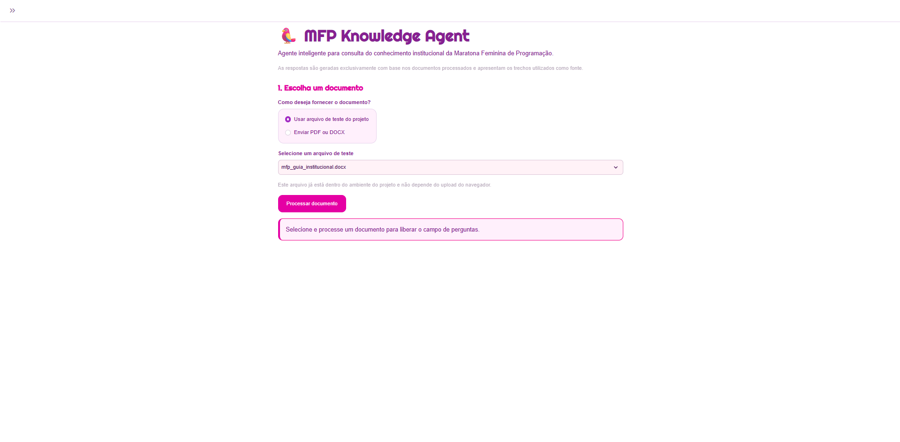
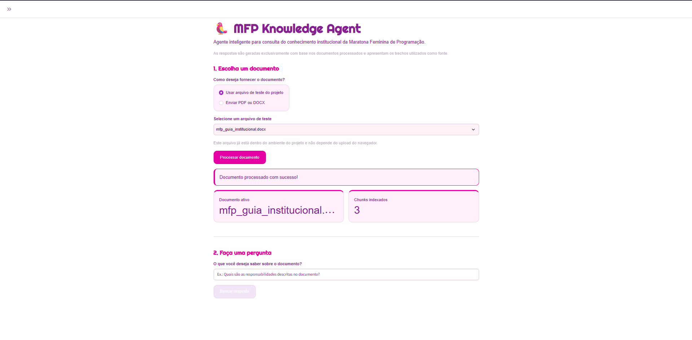
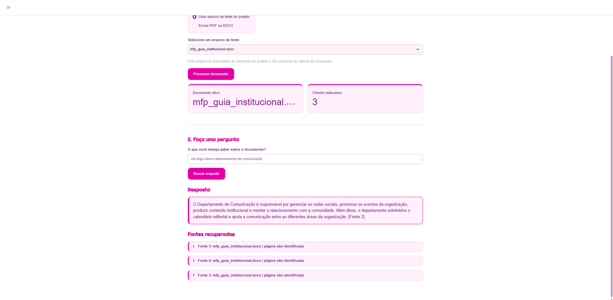
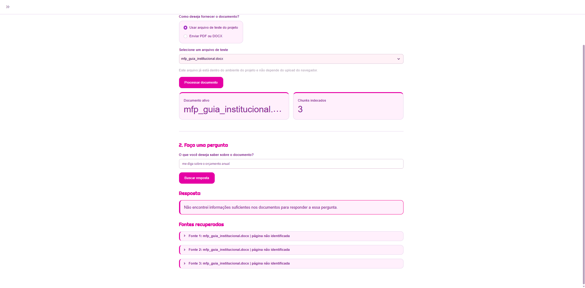

# ⭐ MFP Knowledge Agent

Agente inteligente para consulta e preservação do conhecimento institucional da **Maratona Feminina de Programação**.

O projeto utiliza **Retrieval-Augmented Generation (RAG)** para permitir perguntas em linguagem natural e gerar respostas fundamentadas nos documentos processados, acompanhadas das fontes utilizadas.

> **Status:** MVP funcional, avaliado e documentado.

---

## Demonstração

### Tela inicial



### Documento processado



### Resposta fundamentada



### Tratamento de informação não encontrada



## Aplicação publicada

Acesse a demonstração:

**[Abrir o MFP Knowledge Agent](https://mfp-knowledge-agent.onrender.com)**

> O serviço utiliza uma instância gratuita e pode levar aproximadamente um minuto para iniciar após um período sem acessos.

---

## Problema de negócio

Em organizações formadas por diferentes departamentos, coordenações e pessoas voluntárias, informações importantes podem ficar distribuídas em documentos e registros de gestões anteriores.

Essa fragmentação dificulta:

- localizar informações rapidamente;
- entender processos;
- consultar responsabilidades;
- integrar novas integrantes;
- preservar conhecimento institucional;
- reduzir retrabalho.

---

## Solução

O MFP Knowledge Agent transforma documentos PDF e DOCX em uma base de conhecimento pesquisável.

A aplicação permite:

- processar documentos;
- fazer perguntas em linguagem natural;
- recuperar trechos semanticamente relevantes;
- gerar respostas com IA;
- visualizar as fontes utilizadas;
- identificar informações parcialmente disponíveis;
- recusar perguntas sem fundamento documental.

---

## Funcionalidades

- Leitura de PDF e DOCX.
- Extração de texto.
- Preservação das páginas dos PDFs.
- Chunking com sobreposição.
- Embeddings reais com Cohere.
- Armazenamento vetorial com ChromaDB.
- Busca semântica.
- Respostas com LLM real.
- Indicação das fontes.
- Tratamento de respostas parciais.
- Recusa quando não há evidência.
- Documento fictício para demonstração.
- Interface em Streamlit.
- Avaliação com dez perguntas.

---

## Arquitetura resumida

```text
PDF ou DOCX
    ↓
Extração do texto
    ↓
Divisão em chunks
    ↓
Embeddings com Cohere
    ↓
ChromaDB
    ↓
Pergunta
    ↓
Busca semântica
    ↓
Trechos relevantes
    ↓
LLM
    ↓
Resposta + fontes
```

Documentação completa:

- docs/architecture.md
- docs/prompts.md
- docs/decisions.md

---

## Tecnologias

| Tecnologia | Utilização |
|---|---|
| Python 3.12 | Linguagem principal |
| Streamlit | Interface |
| Cohere API | Embeddings e respostas |
| ChromaDB | Banco vetorial |
| PyPDF | Leitura de PDF |
| python-docx | Leitura de DOCX |
| python-dotenv | Variáveis de ambiente |
| GitHub | Versionamento e documentação |
| GitHub Codespaces | Ambiente de desenvolvimento |

---

## Estrutura

```text
mfp-knowledge-agent/
├── app.py
├── README.md
├── requirements.txt
├── .env.example
├── .gitignore
├── .streamlit/
│   └── config.toml
├── assets/
│   ├── styles.css
│   └── Images/
├── data/
│   └── sample/
│       └── mfp_guia_institucional.docx
├── docs/
│   ├── architecture.md
│   ├── decisions.md
│   └── prompts.md
├── evaluation/
│   ├── questions.json
│   └── results.json
├── src/
│   ├── document_loader.py
│   ├── embeddings.py
│   ├── generator.py
│   ├── text_splitter.py
│   └── vector_store.py
└── tests/
    └── test_document_upload.py
```

---

## Como executar

### Clonar

```bash
git clone https://github.com/Nandsbeltrao/mfp-knowledge-agent.git
cd mfp-knowledge-agent
```

### Criar o ambiente

```bash
python3.12 -m venv .venv
```

Linux ou macOS:

```bash
source .venv/bin/activate
```

Windows PowerShell:

```powershell
.venv\Scripts\Activate.ps1
```

### Instalar dependências

```bash
python -m pip install --upgrade pip
pip install -r requirements.txt
```

### Configurar a Cohere

Crie `.env`:

```env
COHERE_API_KEY=sua_chave_aqui
COHERE_EMBEDDING_MODEL=embed-v5.0-fast
COHERE_CHAT_MODEL=command-a-plus-05-2026
```

Nunca publique a chave.

### Executar

```bash
streamlit run app.py
```

A aplicação estará disponível em:

```text
http://localhost:8501
```

---

## Exemplos

### Pergunta respondível

```text
Quais são as responsabilidades do Departamento de Comunicação?
```

### Pergunta parcialmente respondível

```text
Qual ferramenta é utilizada para organizar as tarefas dos eventos?
```

O agente informa que existe uma lista de tarefas, mas esclarece que nenhuma ferramenta foi especificada.

### Pergunta não respondível

```text
Qual é o orçamento anual da organização?
```

Resposta esperada:

```text
Não encontrei informações suficientes nos documentos para responder a essa pergunta.
```

---

## Avaliação

| Categoria | Quantidade | Resultado |
|---|---:|---:|
| Respondíveis | 5 | 5 aprovadas |
| Parcialmente respondíveis | 2 | 2 aprovadas |
| Não respondíveis | 3 | 3 aprovadas |
| **Total** | **10** | **10 aprovadas** |

No conjunto avaliado:

- 10 testes foram executados;
- 10 testes foram aprovados após o ajuste final;
- nenhuma alucinação foi identificada;
- todas as perguntas não respondíveis foram recusadas corretamente.

Detalhes:

- evaluation/questions.json
- evaluation/results.json

---

## Teste do processamento de arquivos

Execute:

```bash
PYTHONPATH=. python tests/test_document_upload.py
```

O teste verifica o processamento de PDF e DOCX em objetos equivalentes aos arquivos recebidos pelo uploader.

---

## Segurança

- A chave da API não fica no código.
- O `.env` não é versionado.
- A `.venv` não é versionada.
- O ChromaDB local não é versionado.
- O documento demonstrativo contém dados fictícios.
- Documentos confidenciais não devem ser utilizados sem autorização.
- Dados de teste devem ser fictícios, anonimizados ou autorizados.

---

## Limitações

- DOCX não possui paginação confiável.
- PDFs digitalizados exigem OCR.
- O MVP trabalha com um documento ativo por vez.
- A avaliação utiliza um conjunto pequeno de perguntas.
- O ChromaDB está configurado localmente.
- A aplicação ainda não possui autenticação.
- O upload apresentou incompatibilidade com o proxy do Codespaces.
- A chave de avaliação da Cohere não é destinada a produção comercial.

---

## Possíveis evoluções

- Vários documentos simultâneos.
- Organização por departamento.
- Identificação de documentos desatualizados.
- Comparação entre versões.
- OCR.
- Autenticação.
- Controle de acesso.
- Histórico de conversas.
- Banco vetorial gerenciado.
- Integração com SharePoint ou Google Drive.
- Avaliação automatizada.
- Monitoramento de custos e uso.

---

## Status

### Concluído

- [x] PDF e DOCX.
- [x] Chunking.
- [x] Embeddings reais.
- [x] Banco vetorial.
- [x] Busca semântica.
- [x] LLM real.
- [x] Fontes.
- [x] Respostas parciais.
- [x] Recusa sem evidência.
- [x] Interface.
- [x] Documento demonstrativo.
- [x] Avaliação manual.
- [x] Teste do processamento de upload.
- [x] Screenshots.
- [x] Arquitetura.
- [x] Prompts.
- [x] Decisões técnicas.
- [x] Publicação em ambiente externo.
- [x] Validação do upload fora do proxy do Codespaces.

---

## Autora

Desenvolvido por **Fernanda Leite** como projeto de portfólio para demonstrar a aplicação de inteligência artificial generativa na resolução de um problema real de gestão do conhecimento.

---

## Aviso

Este é um projeto de demonstração.

O documento institucional incluído no repositório contém informações fictícias criadas exclusivamente para testar a aplicação.

O uso em ambiente real exige revisão de segurança, privacidade, persistência, autenticação e controle de acesso.